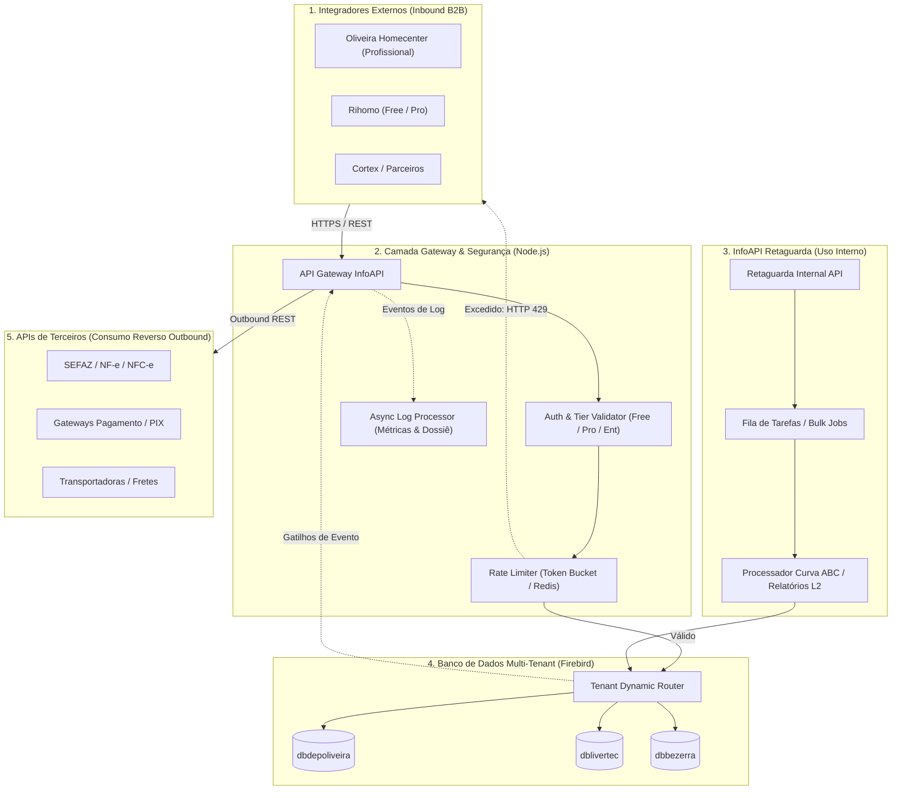
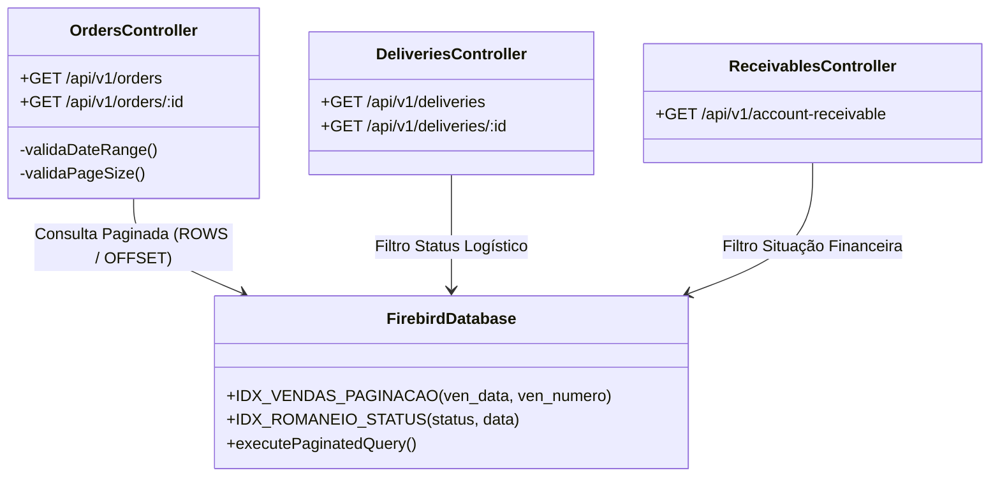
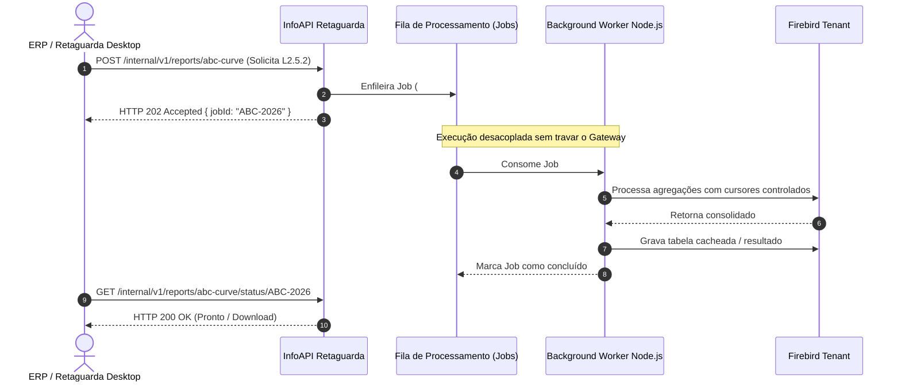
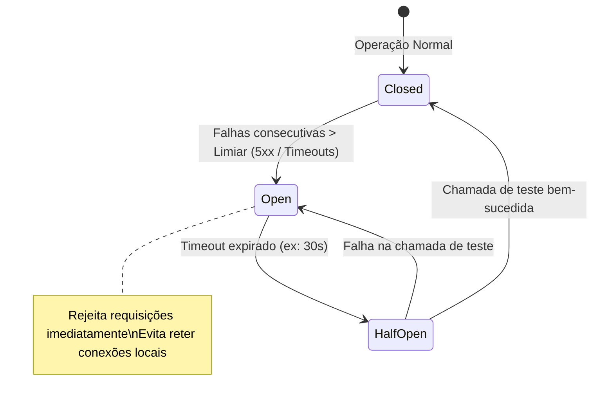
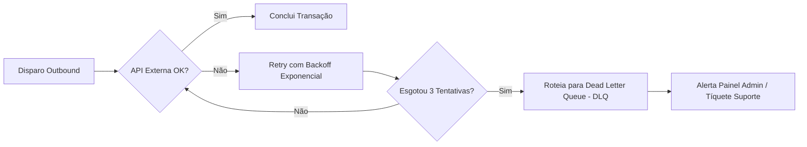

<!-- =========================================================================
     CAPA (COVER PAGE)
     ========================================================================= -->

    
  

    INFOBRASIL SISTEMAS • ENGENHARIA DE SOFTWARE & ARQUITETURA
  

   
  <h1 style="font-size: 32px; font-weight: 800; color: #0f172a; margin-bottom: 8px;">
    DOCUMENTO DE ARQUITETURA & ESPECIFICAÇÃO TÉCNICA
  </h1>
  <h2 style="font-size: 20px; font-weight: 600; color: #334155; margin-top: 0;">
    Ecossistema de Integrações InfoAPI
  </h2>
  

    Guia arquitetural unificado: Inbound APIs (B2B), Barramento Interno (InfoAPI Retaguarda) e Integrações Reversas (Outbound Third-Party).
  

    
  

    <strong>Autor:</strong> Gabriel Camurça 
    <strong>Versão Atual:</strong> 1.17.1 (Build 64) 
    <strong>Data de Emissão:</strong> Outubro de 2026 
    <strong>Classificação:</strong> Confidencial / Uso Interno & Parceiros Homologados
  

     

<!-- =========================================================================
     CONTRACAPA & FICHA CATALOGRÁFICA TÉCNICA
     ========================================================================= -->

## Ficha de Controle e Governança do Documento

| Parâmetro | Detalhes do Registro |
| :--- | :--- |
| **Título do Documento** | Especificação Arquitetural e Operacional do Ecossistema InfoAPI |
| **Identificador / ID** | DOC-ENG-INFOAPI-2026-V1.17 |
| **Stack Primária** | Node.js (Gateway & Serviços) + Firebird SQL (Multi-tenant DBs) |
| **Repositório Central** | `git.infobrasil.com.br/core/infoapi-ecosystem` |
| **Aprovadores** | Gabriel Camurça (Tech Lead) / Diretoria InfoBrasil |
| **Status do Ciclo de Vida** | Homologado em Produção (v1.17.1) |

---

### Histórico de Revisões e Deploys

| Versão | Data | Autor | Resumo das Alterações |
| :---: | :---: | :--- | :--- |
| `0.1.0` | Jun/2026 | Gabriel Camurça | Especificação inicial do gateway REST e conexão de tenants. |
| `1.0.0` | Jul/2026 | Gabriel Camurça | Implementação de Rate Limiting (429) e criação de índices compostos em `VENDAS`. |
| `1.10.0`| Ago/2026 | Gabriel Camurça | Estruturação comercial por Tiers (Free, Profissional, Enterprise) e Log Processor. |
| `1.15.0`| Set/2026 | Gabriel Camurça | Módulo de chamadas reversas (SEFAZ/PIX) e desacoplamento da InfoAPI Retaguarda. |
| `1.17.1`| Out/2026 | Gabriel Camurça | Versão consolidada (Deploy #64): Sistema de tíquetes, paginação `pageSize=500`. |

<!-- =========================================================================
     SUMÁRIO (TABLE OF CONTENTS)
     ========================================================================= -->

## Sumário Executivo

1. [Visão Geral & Objetivos Estratégicos](#1-visão-geral--objetivos-estratégicos)
2. [Macroarquitetura do Ecossistema InfoBrasil](#2-macroarquitetura-do-ecossistema-infobrasil)
3. [Pilar 1: InfoAPI Corporativa (Inbound B2B)](#3-pilar-1-infoapi-corporativa-inbound-b2b)
   * 3.1. [Catálogo de Endpoints e Índices](#31-catálogo-de-endpoints-e-índices)
   * 3.2. [Governança de Quotas, Rate Limit e Tiers](#32-governança-de-quotas-rate-limit-e-tiers)
4. [Pilar 2: InfoAPI Retaguarda (Uso Interno e Background)](#4-pilar-2-infoapi-retaguarda-uso-interno-e-background)
   * 4.1. [Objetivos e Casos de Uso Especializados](#41-objetivos-e-casos-de-uso-especializados)
   * 4.2. [Topologia de Filas e Processamento em Lote](#42-topologia-de-filas-e-processamento-em-lote)
5. [Pilar 3: Integrações Reversas (Outbound Third-Party)](#5-pilar-3-integrações-reversas-outbound-third-party)
   * 5.1. [Conectores Fiscais, Bancários e Logísticos](#51-conectores-fiscais-bancários-e-logísticos)
   * 5.2. [Políticas de Resiliência: Circuit Breaker, Retries e DLQ](#52-políticas-de-resiliência-circuit-breaker-retries-e-dlq)
6. [Segurança, Autenticação e Multi-Tenancy](#6-segurança-autenticação-e-multi-tenancy)
7. [Observabilidade, Métricas e Portal do Desenvolvedor](#7-observabilidade-métricas-e-portal-do-desenvolvedor)
8. [Roadmap Técnico & Considerações Finais](#8-roadmap-técnico--considerações-finais)

---

<!-- =========================================================================
     CORPO DO DOCUMENTO (SEÇÕES TÉCNICAS E DIAGRAMAS)
     ========================================================================= -->

## 1. Visão Geral & Objetivos Estratégicos

*(Inserir texto descritivo: motivação de negócio, evolução de monólito para barramento orientado a APIs, contexto da stack Node.js + Firebird e redução de gargalos de I/O).*

---

## 2. Macroarquitetura do Ecossistema InfoBrasil

O ecossistema é dividido em três fluxos distintos de dados:
* **Inbound B2B (InfoAPI Externa):** Clientes integradores consultando o ERP.
* **Internal Barramento (InfoAPI Retaguarda):** Sincronizações internas e jobs operacionais sem expor limites públicos.
* **Outbound Reversa:** O ERP/API consumindo serviços de terceiros (SEFAZ, Bancos, Logística).

---

## 3. Pilar 1: InfoAPI Corporativa (Inbound B2B)

*(Inserir introdução detalhando a comunicação pública, padrões de payload JSON, convenções REST e cabeçalhos).*

### 3.1. Catálogo de Endpoints e Índices

*(Preencher miolo com tabela de rotas detalhadas, payloads e regras de paginação).*

### 3.2. Governança de Quotas, Rate Limit e Tiers

*(Preencher miolo com detalhamento técnico dos limites por plano, políticas de burst e status code HTTP 429).*

---

## 4. Pilar 2: InfoAPI Retaguarda (Uso Interno e Background)

### 4.1. Objetivos e Casos de Uso Especializados

*(Inserir texto descritivo justificando o porquê da criação da InfoAPI Retaguarda: isolamento de tráfego de retaguarda, tarefas pesadas de fechamento de caixa, Curva ABC, consolidação de dados).*

### 4.2. Topologia de Filas e Processamento em Lote

---

## 5. Pilar 3: Integrações Reversas (Outbound Third-Party)

### 5.1. Conectores Fiscais, Bancários e Logísticos

*(Inserir descrição do pipeline de saída, quando a InfoBrasil atua como cliente consumindo serviços externos).*

### 5.2. Políticas de Resiliência: Circuit Breaker, Retries e DLQ

---

## 6. Segurança, Autenticação e Multi-Tenancy

*(Preencher miolo com modelo de API Keys, cabeçalhos de autenticação, rotação de chaves e conexão dinâmica por tenant).*

---

## 7. Observabilidade, Métricas e Portal do Desenvolvedor

*(Preencher miolo detalhando o Log Processor, exportação do Dossiê em PDF, painel administrativo e a aba de Solicitações/Tíquetes).*

---

## 8. Roadmap Técnico & Considerações Finais

*(Preencher miolo com itens futuros: OpenAPI/Swagger interativo, implementação de Webhooks para clientes pagantes, cache Redis para rotas de clientes).*

---

<!-- =========================================================================
     CONTRACAPA FINAL
     ========================================================================= -->

      
  <h3 style="color: #059669; font-size: 16px; letter-spacing: 1.5px; text-transform: uppercase;">
    INFOBRASIL SISTEMAS
  </h3>
  

    Inovação em Gestão e Infraestrutura de APIs Corporativas
  

   
  

    Este documento é propriedade da InfoBrasil Sistemas. As informações técnicas contidas neste manual são restritas ao time de Engenharia e integradores devidamente autorizados sob termo de confidencialidade (NDA).
  

   
  

    Fortaleza — CE • 2026
  

