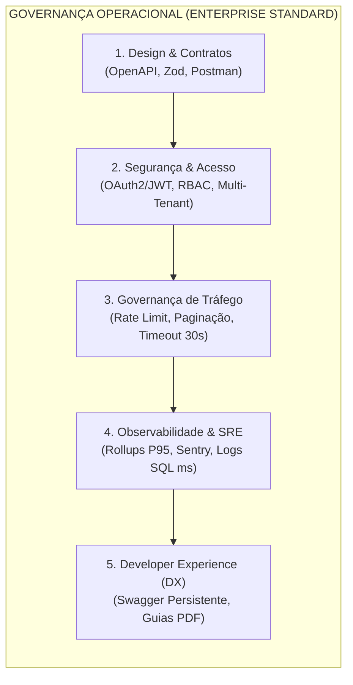
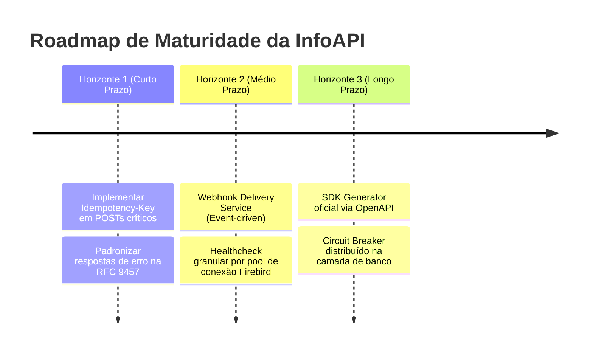

# Relatório Técnico: Avaliação de Maturidade da InfoAPI

**Documento:** Dossiê Arquitetural de Maturidade de API  
**Data da Avaliação:** 14 de Novembro de 2026  
**Avaliador:** Staff Software Engineer / Arquiteto Mentor  
**Escopo da Análise:** InfoAPI (NestJS 11, TypeScript, Prisma ORM, PostgreSQL & Firebird Multi-Tenant)  

---

## 1. Sumário Executivo & Metodologia

O objetivo deste relatório é submeter a **InfoAPI** a uma rigorosa auditoria de maturidade técnica, fundamentada em duas escolas consagradas de engenharia de software:

1. **Escola Clássica / Arquitetural:** *Richardson Maturity Model (RMM)* — decompõe a adesão aos princípios REST originais (Recursos, Verbos HTTP e Hipermídia/HATEOAS).
2. **Escola Contemporânea / Operacional:** *API Ops & Enterprise Governance Framework* — avalia a API como um **produto de engenharia de missão crítica**, cobrindo Segurança, Contratos (*API-First*), Resiliência, Observabilidade e *Developer Experience (DX)*.

### Contexto de Engenharia da InfoAPI
A InfoAPI atua como um **Gateway de Integração Crítico** entre ecossistemas cloud modernos (e-commerces, CRMs, hubs de marketplace, plataformas logísticas e PDVs móveis) e bases de dados relacionais on-premise legadas (**Firebird 2.5/3.0**) distribuídas por tenant, orquestradas por metadados centrais em **PostgreSQL**.

### Scorecard de Maturidade Geral

| Dimensão Avaliada | Modelo de Referência | Nota (0 a 5) | Status de Maturidade |
| :--- | :--- | :---: | :--- |
| **Arquitetura REST (RMM)** | Richardson Maturity Model | **3.8 / 5.0** | **Nível 2 Consolidado** (Verbos & Recursos Plenos; HATEOAS ausente por decisão técnica) |
| **Contratos & Design API-First** | Enterprise Governance | **4.7 / 5.0** | **Maduro** (OpenAPI 3.0 vivo, Zod espelhado, Postman gerado em CI) |
| **Segurança & Controle de Acesso** | OWASP API Security / OAuth2 | **4.6 / 5.0** | **Enterprise** (JWT RS256/HS256 com `expires_in`, RBAC granular, IP blocklist) |
| **Governança de Tráfego & Resiliência**| API Ops / SRE | **4.2 / 5.0** | **Robusto** (Rate limiting por plano/tenant, paginação com contagem opcional, timeouts 30s) |
| **Observabilidade & Telemetria** | SRE / Continuous Management | **4.4 / 5.0** | **Avançado** (Rollups horários P95, RequestLog PostgreSQL, rastreamento SQL ms, Sentry) |
| **Developer Experience (DX)** | API as a Product | **4.8 / 5.0** | **Exemplar** (Swagger/Scalar persistente, guias técnicos em PDF, changelog automatizado) |

---

## 2. Escola 1: Richardson Maturity Model (RMM)

O modelo de Leonard Richardson avalia a transição gradual de sistemas RPC arbitrários para arquiteturas que usam plenamente o potencial semântico da Web.

```
+-------------------------------------------------------------------+
|  NÍVEL 3: Controles Hipermídia (HATEOAS - Navegação via Links)   | -> Não Adotado (Trade-off B2B)
+-------------------------------------------------------------------+
|  NÍVEL 2: Verbos HTTP Semânticos & Status Codes Padronizados      | -> [INFOAPI ATUAL: 100% CONSOLIDADO]
+-------------------------------------------------------------------+
|  NÍVEL 1: Identificação Granular de Recursos (URIs Dedicadas)     | -> [INFOAPI ATUAL: 100% CONSOLIDADO]
+-------------------------------------------------------------------+
|  NÍVEL 0: The Swamp of POX (Túnel RPC sobre HTTP único)           | -> Superado
+-------------------------------------------------------------------+
```

---

### Nível 0: The Swamp of POX (Superado)
* **Critério:** Utilizar HTTP apenas como mecanismo de transporte remoto, concentrando múltiplas operações distintas em um único endpoint (geralmente `POST /api` ou SOAP/XML-RPC).
* **Diagnóstico na InfoAPI:** **100% Superado.** Não há túneis RPC ou payloads com campos de comando tipo `action: "update_client"` enviados a um router central.

---

### Nível 1: Identificação de Recursos via URIs (Conformidade: 95%)
* **Critério:** Mapeamento de entidades de negócio em URIs independentes e substantivas, permitindo identificação unívoca de cada recurso.
* **Diagnóstico na InfoAPI:**
  - **Recursos de Primeira Classe:** Identificados de forma limpa e pluralizada:
    - `/clients`, `/clients/:id`
    - `/orders`, `/orders/:id`
    - `/products`, `/products/id/:id`, `/products/barcode/:barcode`
    - `/production-order`, `/production-order/:id`
    - `/purchases`, `/purchases/:id`
    - `/deliveries`, `/deliveries/status`
    - `/account-payable`, `/account-receivable`
  - **Recursos Transversais / Agregações Analíticas:** Para viabilizar cenários analíticos e relatórios sem sobrecarregar recursos pai, a API adota URIs especializadas:
    - `/order-items` (Itens de venda transversais)
    - `/purchase-items` (Itens de compras com múltiplos filtros fiscais)
    - `/products/stock` (Snapshot consolidado de estoque multiloja)
    - `/orders/abc-curve` (Classificação analítica de Pareto)
  - **Pontos de Atenção:** Pequenas variações de nomenclatura singular vs plural em módulos legados (ex: `/production-order` e `/purchase` convivendo com `/purchases`). A maioria já possui *aliases* de compatibilidade.

---

### Nível 2: Verbos HTTP Semânticos & Status Codes (Conformidade: 90%)
* **Critério:** Utilizar os métodos HTTP de acordo com sua semântica de protocolo (mutações seguras vs inseguras, idempotência) e fornecer status codes que reflitam fielmente o resultado operacional.
* **Diagnóstico na InfoAPI:**
  - **Uso Estrito de Métodos:**
    - `GET`: Idempotente e estritamente de leitura (zero efeitos colaterais).
    - `POST`: Criação de recursos com retorno de cabeçalho e chave gerada (`201 Created` ou `200 OK`).
    - `PATCH`: Mutações parciais em conformidade com RFC 5789 (`PATCH /clients/:id`, atualizando exclusivamente as colunas enviadas sem sobrescrever o restante com `null`).
  - **Status Codes Padronizados:**
    - `200 OK`: Sucesso em consultas e atualizações.
    - `201 Created`: Criação bem-sucedida (`POST /production-order`, `POST /clients`).
    - `400 Bad Request`: Rejeição imediata de schemas Zod inválidos, violações de data ou regras de negócio.
    - `401 Unauthorized`: Falha de Basic Auth ou token JWT ausente/expirado.
    - `403 Forbidden`: Bloqueio por permissão RBAC insuficiente ou acesso cruzado a outra filial/loja não permitida.
    - `404 Not Found`: Recurso inexistente (ex: pedido ou cliente não encontrado).
    - `429 Too Many Requests`: Cota de requisições excedida pelo interceptor de plano.
    - `500 Internal Server Error`: Falhas críticas de infraestrutura ou erros de SQL do Firebird encapsulados.
  - **A Ausência Intencional do `DELETE`:** Na InfoAPI, a maioria das entidades (pedidos, clientes, notas fiscais, ordens de produção) não expõe o verbo `DELETE`. Trata-se de uma **restrição mandatória do domínio fiscal/ERP**, onde exclusões físicas quebram integridade contábil e referencial no Firebird, sendo substituídas por inativações de situação via `PATCH (CLI_SITUACAO = 'I')`.

---

### Nível 3: Controles Hipermídia (HATEOAS) (Conformidade: 10% — Não Adotado)
* **Critério:** As respostas da API devem conter links hipermidiáticos (`_links` / HAL / JSON:API) que ensinam o cliente em tempo de execução quais estados e ações são possíveis a partir daquele ponto.
* **Diagnóstico na InfoAPI:** **Não implementado propositalmente.**
* **Análise Crítica de Engenharia (Trade-off):**
  - O HATEOAS foi concebido para navegação estilo navegador na Web. No desenvolvimento de software B2B moderno com ecossistemas orientados a microsserviços e frontends modernos, HATEOAS impõe:
    1. **Overhead de Payload:** Aumento substancial do volume de tráfego JSON (URLs redundantes para cada item de uma lista de 500 registros de produtos).
    2. **Complexidade de Parsing:** Dificulta a tipagem estática e geração de SDKs tipados em TypeScript, C# e Java.
  - **A Substituição pelo Contrato OpenAPI:** A InfoAPI substituiu o Nível 3 dinâmico por **metacontratos estáticos universais (OpenAPI 3.0 / Swagger)**. O integrador sabe com antecedência, em tempo de compilação/desenvolvimento, exatamente quais rotas existem, seus parâmetros e seus esquemas de retorno, eliminando a necessidade de descoberta dinâmica em runtime.

> **Veredito da Escola 1 (RMM):** A InfoAPI opera no **ápice do Nível 2 (Verbos & Recursos)**, dispensando o Nível 3 em favor de eficiência de rede e tipagem forte via OpenAPI.

---

## 3. Escola 2: API Ops, Governança & Maturidade Operacional

Enquanto o modelo de Richardson foca na semântica de protocolo, a escola de Governança Operacional avalia se a API está pronta para sobreviver em produção, escalar sob tráfego hostil e fornecer uma experiência confiável de plataforma.



---

### Dimensão A: Design & Contratos (API-First & DTO Enforcement)
* **Maturidade: Nível 4 (Avançado)**
* **Pontos Fortes:**
  - **Validação Sistemática de Borda (Zod + NestJS):** Seguindo a [ADR 003](file:///c:/dev/info-api/docs/adrs/003_validacao_sistematica_de_limites_de_campos_zod_prisma.md), todos os payloads e query strings são sanitizados com limites de caracteres sincronizados diretamente com as restrições físicas do PostgreSQL e do Firebird, impedindo estouros de buffer e injeções de memória antes de atingir o banco.
  - **Geração Automatizada de Artefatos:** Scripts em CI/CD (`npm run swagger:generate` e `npm run postman:generate`) mantêm `swagger-spec.json` e a coleção Postman sincronizados com o código compilado em cada release.
  - **DTOs Isomórficos de Entrada e Saída:** Separação estrita entre `CreateDto`, `UpdateDto` e `ResponseDto`.

---

### Dimensão B: Segurança & Autenticação
* **Maturidade: Nível 5 (Enterprise)**
* **Pontos Fortes:**
  - **Fluxo Híbrido Padronizado:** Autenticação primária via `POST /auth/login` (Basic Auth em header), emissão de par de tokens JWT (`access_token` e `refresh_token`), com exposição explícita de `expires_in` e `refresh_expires_in` para controle milimétrico do ciclo de vida no cliente.
  - **RBAC (Role-Based Access Control) Granular:** Decoradores declarativos `@RequirePermissions({ allOf: ['tenant.orders.view'] })` validados em tempo de execução via `PermissionsGuard` e `PermissionResolver`.
  - **Isolamento Estrito de Tenant:** A identificação do banco de dados (`credentialsId`) e da loja (`storeId`) é resolvida diretamente das claims criptografadas do token JWT, impedindo que um integrador interaja com dados de outro cliente (*Horizontal Privilege Escalation*).
  - **Mitigação Ativa de Ataques (Brute Force):** O `IpBlocklistService` monitora tentativas consecutivas de violação de autenticação e bloqueia temporariamente o endereço IP na borda da aplicação.

---

### Dimensão C: Governança de Tráfego & Resiliência
* **Maturidade: Nível 4 (Robusto)**
* **Pontos Fortes:**
  - **Controle de Vazão Baseado em Planos (`PlanLimitInterceptor`):** Cada usuário possui um plano associado (`Free`, `Pro`, etc.) com limites rígidos de requisições por minuto (`req_min`) e volume mensal (`req_month`), retornando `429 Too Many Requests` com cabeçalho explicativo.
  - **Paginação de Alto Desempenho com Contagem sob Demanda:** Implementação do cabeçalho `X-Request-Count: true`. Por padrão, queries paginadas no Firebird executam apenas `SELECT FIRST ? SKIP ?`, omitindo o custoso `COUNT(*)` sobre tabelas volumosas caso o integrador não necessite de metadados de paginação.
  - **Timeouts Agressivos de Conexão:** Redução do proxy gateway de 300s para 30s (`658ca9b`), forçando falha rápida (*fail fast*) e evitando acúmulo de conexões pendentes (*connection pool exhaustion*) no Firebird.
* **Gargalo Identificado:** Ausência de controle de **Idempotência de Mutações** via cabeçalho HTTP (`Idempotency-Key`). Em casos de queda de rede pós-processamento, uma nova tentativa de `POST /orders` pode gerar pedidos duplicados caso o integrador não valide externamente.

---

### Dimensão D: Observabilidade, Auditoria & SRE
* **Maturidade: Nível 4 (Avançado)**
* **Pontos Fortes:**
  - **Auditoria Transacional Centralizada:** Todas as requisições que trafegam pela API são persistidas no PostgreSQL na tabela `request_logs` com IP, rota, método, tempo de resposta em milissegundos (`duration_ms`), status code e usuário autenticado.
  - **Rollups Horários Agregados:** O serviço `DashboardHourlyRollup` pré-computa métricas consolidadas (Volume total, Sucessos, Erros 4xx/5xx, Rate Limits, Latência Média e **Latência P95**), permitindo geração instantânea de relatórios sem onerar a base com queries agregadas sobre milhões de registros.
  - **Rastreamento de Performance de I/O:** O `ClientService`, `OrderService` e `ProductionOrderService` registram explicitamente o tempo gasto exclusivamente na query SQL (`endTime - startTime`) em cada consulta.
  - **Monitoramento de Erros Não Tratados:** Integração com `@sentry/node` com captura automática de exceções e contexto enriquecido de usuário.

---

### Dimensão E: Developer Experience (DX) & Onboarding
* **Maturidade: Nível 5 (Exemplar)**
* **Pontos Fortes:**
  - **Documentação Dupla e Interativa:** Disponibilização simultânea de **Swagger UI** (foco em execução e testes com persistência de token) e **Scalar** (foco em leitura limpa e navegação moderna de endpoints).
  - **Coleção Postman Oficial com Auto-Auth:** Scripts embutidos de pré-requisição que realizam login automático e atualizam a variável de ambiente `{{jwt}}` para todas as chamadas da coleção.
  - **Dossiês Técnicos de Integração em PDF:** Produção de guias passo a passo padronizados (ex: Guia Giro de Estoque L2.11.1, Curva ABC L2.5.2 e Ordens de Produção OP.1.0) desenhados sob a diretriz `docs/guidelines/pdf-guidance.md`.
  - **Tradução Nativa de Mensagens:** Mensagens de erro de validação padronizadas em Português (`pt-BR`).

---

## 4. Matriz Comparativa: Pontos Fortes vs Gaps Arquiteturais

A tabela abaixo sintetiza o diagnóstico técnico e os trade-offs observados no estado atual da plataforma:

| Aspecto | Implementação Atual na InfoAPI | Classificação | Impacto Operacional / Arquitetural |
| :--- | :--- | :---: | :--- |
| **Modelagem de Recursos** | URIs pluralizadas, limpas e substantivas | Forte | Alta previsibilidade e facilidade de consumo. |
| **Contrato de Autenticação** | JWT com `expires_in` e `refresh_expires_in` | Forte | Permite que SDKs e clientes programem renovações exatas sem desperdício de chamadas. |
| **Validação de Entrada** | Zod schemas com limites espelhados no DDL | Forte | Proteção contra *Arithmetic Exception / String Truncation* e ataques de negação de serviço. |
| **Documentação Viva** | Swagger persistente, Scalar e Postman gerados em CI | Forte | Onboarding acelerado e redução drástica de chamadas de suporte técnico. |
| **Idempotência em Mutações** | Não implementado formalmente (`Idempotency-Key`) | **Gap Crítico** | Risco de duplicação de pedidos ou ordens de produção em retentativas automáticas pós-timeout. |
| **Padronização de Erros** | Exceções padrão NestJS (`{ statusCode, message, error }`) | **Gap Médio** | Funcional, mas não adere aos padrões formais de mercado da RFC 9457 (*Problem Details*). |
| **Notificação de Eventos** | Polling periódico dos clientes (`startDateAlteracao`) | **Gap Médio** | O cliente é forçado a consultar continuamente endpoints de listagem para saber de novidades, gerando I/O ocioso no Firebird. |
| **HATEOAS (Nível 3 RMM)** | Não adotado por design | **Trade-off Consciente** | Reduz sobrecarga de rede e favorece tipagem forte em contratos B2B. |

---

## 5. Roadmap Tático: Evoluindo a InfoAPI para o Nível Máximo

Para elevar a InfoAPI do atual patamar **Nível 2 Avançado / Enterprise Operations** para a maturidade máxima de arquitetura distribuída, recomenda-se o seguinte plano de evolução em 3 horizontes:



### Horizonte 1: Resiliência Transacional & Padronização (Curto Prazo)
1. **Idempotency-Key em Mutações Críticas:**
   - Adicionar interceptor para ler o cabeçalho `Idempotency-Key` em `POST /orders` e `POST /production-order`.
   - Armazenar a chave e o hash do payload no PostgreSQL por 24 horas. Se a mesma requisição chegar durante processamento ou após conclusão, retornar o resultado em cache sem duplicar inserts no Firebird.
2. **Adoção do RFC 9457 (Problem Details for HTTP APIs):**
   - Substituir o payload de erro nativo do NestJS pelo padrão RFC 9457:
     ```json
     {
       "type": "https://info-api.infobrasilsistemas.com.br/errors/resource-not-found",
       "title": "Cliente Não Encontrado",
       "status": 404,
       "detail": "O cliente com ID 1234 não foi localizado na base da Loja 1.",
       "instance": "/api/v1/clients/1234",
       "code": "CLIENT_NOT_FOUND",
       "requestId": "550e8400-e29b-41d4-a716-446655440000"
     }
     ```

### Horizonte 2: Desacoplamento & Redução de Carga de I/O (Médio Prazo)
1. **Substituição de Polling por Webhooks (Event-Driven Architecture):**
   - Desenvolver um serviço de notificações (*Webhook Delivery Engine*) disparado por gatilhos ou rotinas do ERP para notificar integradores sobre:
     - Criação/Faturamento de Pedidos (`order.created`, `order.billed`).
     - Alterações críticas de estoque (`product.stock_updated`).
   - Elimina o consumo desnecessário de CPU e I/O gerado por clientes fazendo requisições em loop a cada 60 segundos.

### Horizonte 3: Governança Avançada & SDKs (Longo Prazo)
1. **Geração Automatizada de SDKs Clientes:**
   - Utilizar o OpenAPI Generator integrado ao pipeline de build para emitir pacotes tipados em NPM (`@infobrasil/api-client`) e NuGet (C# para PDVs legados).
2. **Circuit Breakers Granulares por Tenant:**
   - Se um banco Firebird on-premise de um cliente específico cair ou sofrer lentidão severa, o Circuit Breaker abre imediatamente apenas para aquele `credentialsId`, rejeitando chamadas com `503 Service Unavailable` em 2ms e impedindo o esgotamento do pool de threads da API para os demais clientes.

---

## 6. Conclusão

A **InfoAPI** apresenta um índice de maturidade técnica **altamente sofisticado no mundo real**:
- **Pela Escola de Richardson:** Acomoda-se com excelência no **Nível 2**, combinando design pragmático de recursos com verbos HTTP semânticos, descartando o Nível 3 (HATEOAS) de forma consciente e justificada.
- **Pela Escola de Governança Operacional:** Apresenta características de **plataforma Enterprise madura**, com validação de borda rigorosa (Zod), segurança robusta (OAuth2/RBAC/IP Guard), observabilidade preventiva (Rollups P95 e medição de SQL) e documentação exemplar.

As oportunidades mapeadas (especialmente idempotência de mutações e arquitetura orientada a eventos via webhooks) representam a fronteira natural para transformar a InfoAPI em uma plataforma de classe mundial à prova de falhas de rede.
